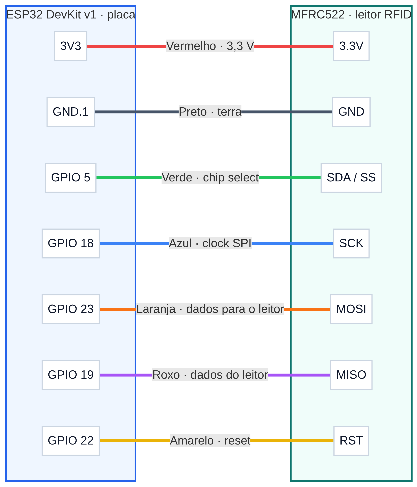
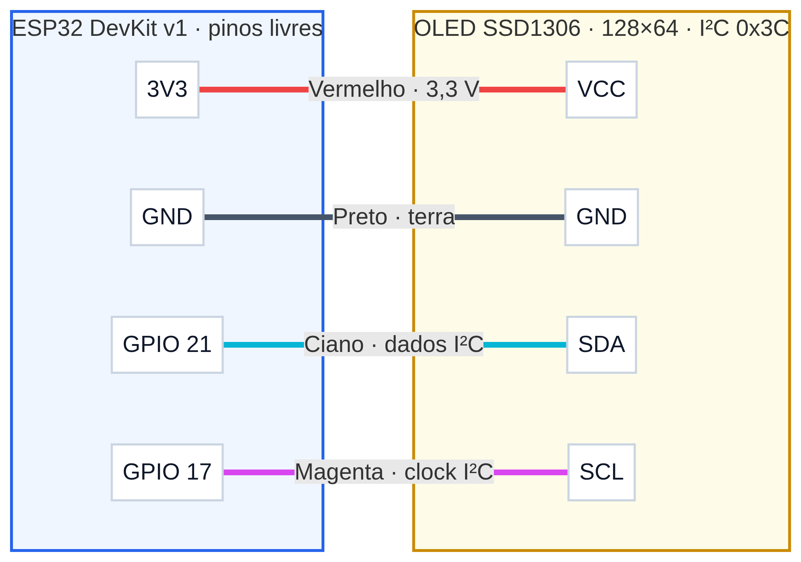

# Mapa do circuito — ESP32, RC522 e OLED

Este documento descreve o circuito combinado definido em [`diagram.json`](diagram.json) e o firmware em [`sketch.ino`](sketch.ino). Ele usa o ESP32 DevKit, o leitor RFID MFRC522 por SPI e um OLED SSD1306 128×64 por I²C.

## Mapas visuais

### Leitor RFID RC522

### Display OLED SSD1306

## Ligações do RC522 — SPI

| Pino indicado no ESP32 | Pino do RC522 | Fio | Função |
|---|---|---|---|
| 3V3 | 3.3V | Vermelho | Alimentação de 3,3 V |
| GND.1 | GND | Preto | Terra comum |
| 5 (GPIO 5) | SDA / SS | Verde | Seleção do leitor (CS/SS no modo SPI) |
| 18 (GPIO 18) | SCK | Azul | Clock SPI |
| 23 (GPIO 23) | MOSI | Laranja | Dados do ESP32 para o leitor |
| 19 (GPIO 19) | MISO | Roxo | Dados do leitor para o ESP32 |
| 22 (GPIO 22) | RST | Amarelo | Reset do leitor |

> **Importante:** no módulo RC522, o pino rotulado `SDA` é usado como `SS/CS` neste circuito SPI. Ele não é o mesmo sinal I²C `SDA` do display OLED.

## Ligações do OLED — I²C

| Pino indicado no ESP32 | Pino do OLED | Fio | Função |
|---|---|---|---|
| 3V3 | VCC | Vermelho | Alimentação de 3,3 V |
| GND.1 | GND | Preto | Terra comum |
| 21 (GPIO 21) | SDA | Ciano | Dados I²C |
| 17 (GPIO 17) | SCL | Magenta | Clock I²C |

- **Endereço I²C:** `0x3C`.
- **Configuração no sketch:** `Wire.begin(21, 17)`, isto é, SDA no GPIO 21 e SCL no GPIO 17.
- O GPIO 22 continua reservado ao `RST` do RC522.

## Como encontrar os pinos no desenho do Wokwi

Na placa ESP32, o Wokwi pode mostrar o número do pino (`5`, `18`, `21`, por exemplo) em vez do texto `GPIO 5` ou `GPIO 21`. Use o número indicado na tabela. Os pinos de alimentação aparecem como `3V3` e `GND`.1` no diagrama atual.

## O que aparece no visor

Ao iniciar, o display mostra **NEXO ESTOQUE / LEITOR PRONTO / Aproxime uma tag**. Ao ler uma tag, mostra **TAG DETECTADA** e a UID; a mesma UID também aparece no Serial Monitor como `RFID_UID=<UID>`. O sketch depende das bibliotecas listadas em [`libraries.txt`](libraries.txt): MFRC522, Adafruit SSD1306, Adafruit GFX e Adafruit BusIO.

A simulação **não envia automaticamente** a UID ao backend do sistema. Copie a UID do visor ou Serial Monitor e cadastre/use-a na página Movimentações do Nexo Estoque.

## Abrir no Wokwi

1. Crie um projeto Arduino para ESP32 no Wokwi ou abra o seu projeto existente.
2. Use o conteúdo de [`diagram.json`](diagram.json) como diagrama do projeto, substituindo o diagrama anterior para incluir também o OLED.
3. Use [`sketch.ino`](sketch.ino) como sketch e mantenha as dependências de [`libraries.txt`](libraries.txt).
4. Inicie a simulação e use o controle de cartão RFID virtual do componente RC522.
5. Confira a mensagem e a UID no visor OLED e no Serial Monitor.

## Cuidados ao montar em hardware físico

Este mapa é para o ESP32 DevKit e módulos de 3,3 V. Use terra comum e alimente o OLED pelo pino `3V3` como no diagrama. Não aplique sinais lógicos de 5 V aos pinos do ESP32. Confirme a pinagem e a tensão do seu modelo específico de módulo antes de ligá-lo fisicamente.

## Referências

- [OLED SSD1306 — documentação do Wokwi](https://docs.wokwi.com/parts/board-ssd1306)
- [RC522 — documentação do Wokwi](https://docs.wokwi.com/parts/board-mfrc522)
- [Formato de diagramas `diagram.json` — documentação do Wokwi](https://docs.wokwi.com/diagram-format)
- [Bibliotecas e exemplos Arduino — Adafruit](https://learn.adafruit.com/monochrome-oled-breakouts/arduino-library-and-examples)
